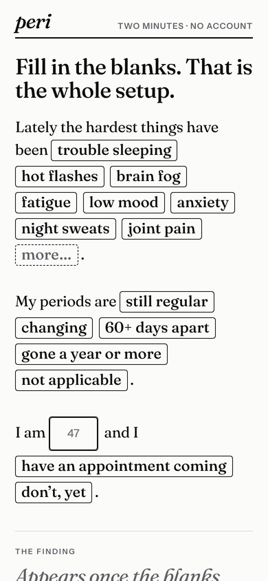
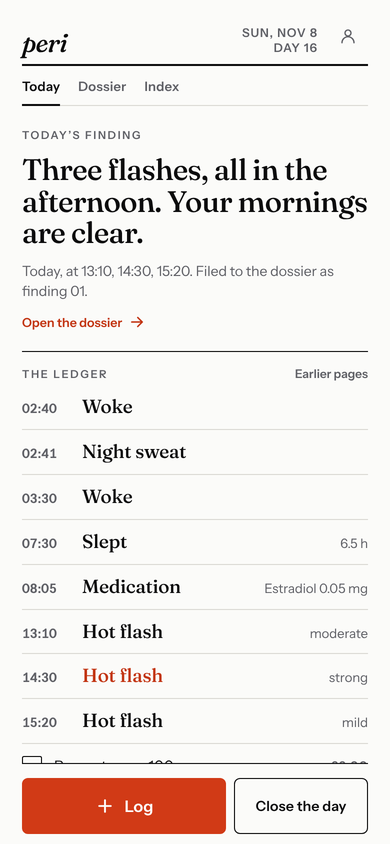
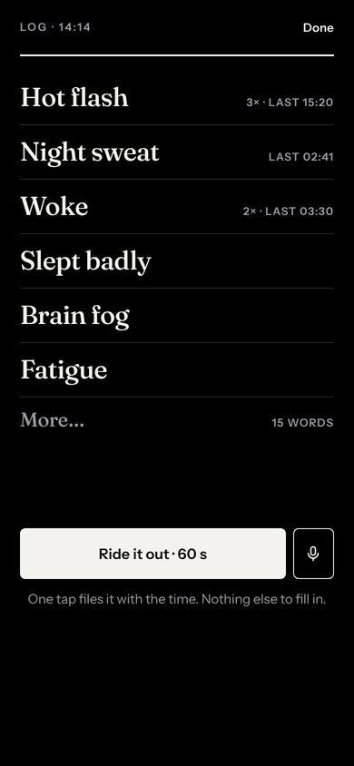
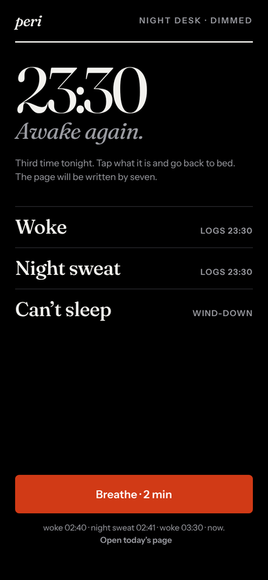
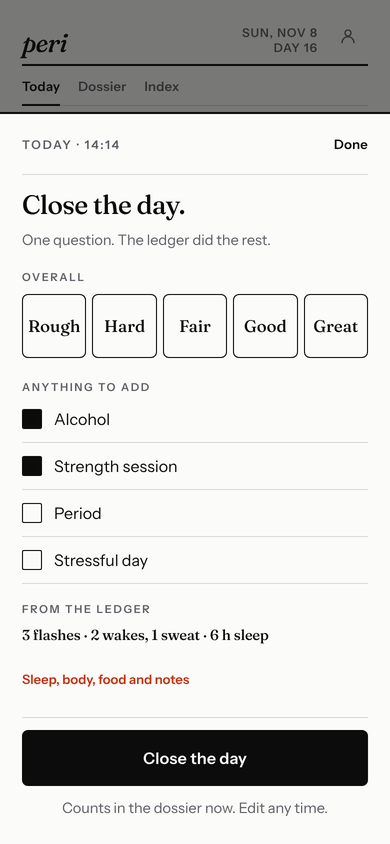
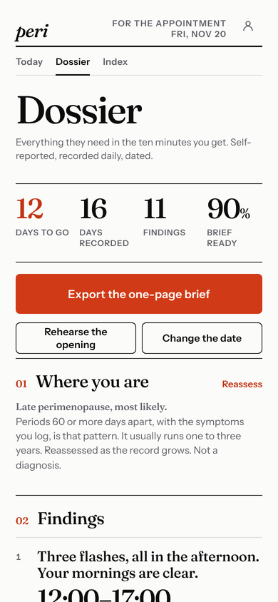
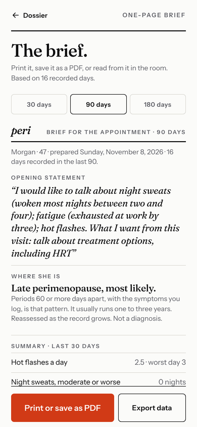
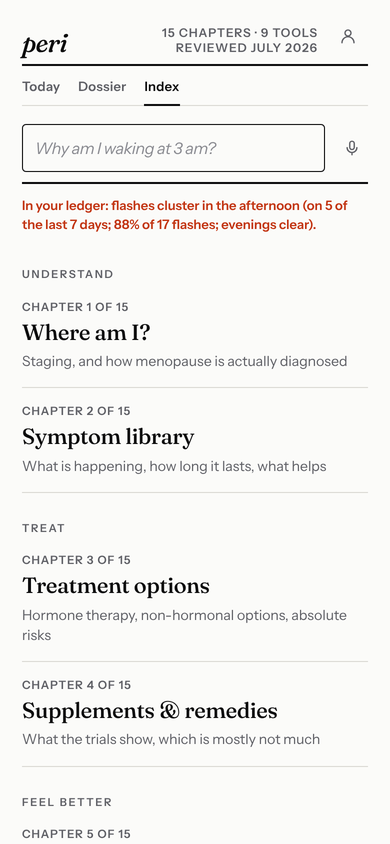

# peri redesign, 2026-11-08: the instrument

The web app (PWA and the WebView inside the Expo shell) was rebuilt around a single idea: peri is
an instrument that keeps a record and writes findings from it, not a companion that asks how you
feel. This file records what changed, what was deliberately kept, and what the native shell still
needs so the iOS app matches.

## What changed

| Before (Pip paper) | Now |
| --- | --- |
| Four tabs: Today, Journey, Care, Guide; floating bottom nav; Profile behind a button | Three: Today, Dossier, Index, in a masthead; You behind the person icon |
| Daily check-in form with ratings for pinned symptoms, confirm button, drafts | A ledger of timestamped moments; one tap files one moment and confirms the day; no drafts |
| Weekly story, Pip reactions, pastel scenes, Bricolage Grotesque | One finding per day, filed to the dossier with a number; Fraunces + Instrument Sans; paper, ink, one vermilion |
| Onboarding wizard (three steps) | A one-page letter with blanks |
| Night-time logging through the same day form | A true-black night desk between 22:00 and 06:00 with three large targets and a wind-down |
| Care tab: treatments, report, brief in cards | Dossier: seven numbered sections, the brief as a printable one-page export, Rehearse |
| Guide: module list with search | Index: fifteen chapters in four groups, nine tools, one search that also matches symptoms and names the pattern in your own ledger |

`design-reference/pip-paper-spec.md` and `design-qa.md` describe the previous system; they stay
in the repository because `marketing/` and the store tooling were built against it.

### Schema v9

`entries[date].moments` is the source of truth: `{id, t:'HH:MM', k, s?, n?, v?, d?}` with `k` from
`MOMENT_KINDS`. `rollupMoments()` derives `hf`, `ns`, `wakes`, `sym.*`, `bleed`, `sleepH` and
`notes`, so the insights engine, charts, CSV, the brief and the native widgets keep working on
day-level fields. New fields: `rating` (0 to 4, from Close the day), `wakes`, `profile.periodStatus`,
`appointments.evidence[]`, `findings{}` (first-seen dates). `migrate()` and `validateBackup()` keep
the strict allowlist; v1 to v8 records migrate in place and invalid moments are dropped rather
than failing the import.

Rollup rules worth knowing: `ns` keeps its 0–4 severity meaning (an unrated sweat is moderate; the
count of sweats stays in the ledger), `hf` and `wakes` are counts, and a value typed in Details is
never overwritten downward by the ledger. For the findings, a night belongs to the morning it ends
on (after 22:00 the evening before through noon), and a night counts as observed only when something
was said about it (a wake, a sweat, a typed count, or the day was closed).

### Contracts kept

- Storage key `menocompass.v1`; native persistence through `window.__MENO_PERSISTED_STATE__`, with
  the WebView local-storage copy removed in native mode.
- Native events: `persist-state`, `navigation-state` (route names `today`, `dossier`, `index`,
  `profile`, `appointment-report` plus a `night` flag; the 1.2 shell's `journey`/`care`/`guide`
  hashes are still accepted on the way in), `checkin-confirmed` the first time a day is confirmed,
  `share-file`, `share-report`, `open-pro-paywall`, `restore-purchases`, the OTA
  `menocompass-prepare-update` handshake, and the `confirmed` flag the widgets read.
- Hash routes: `#checkin` opens the log sheet, `#care` opens the treatments sheet on the dossier,
  `#journey`, `#trends`, `#meds` go to the dossier, `#guide` and `#learn` to the index,
  `#report` to the one-page brief, `#settings` and `#profile` to You, `#redflags` to the chapter.
- Pro gating on iOS: the dossier and the brief lock when `__MENO_PRO_ACTIVE__ !== true` and
  `__MENO_NATIVE_SUBSCRIPTIONS__ !== false`; the lock panel posts `open-pro-paywall`.
- Offline shell: `sw.js` cache `v23` lists the four font files and the new icons; the mobile sync
  inlines the fonts as base64 so the WebView has no network dependency.
- The letter asks how long ago the last period was when periods have stopped
  (`profile.periodSince`: `lt2`, `2to6`, `gt6`); staging waits for that blank.
- Content, staging logic, insight rules, appointment-question suggestions, treatment follow-ups,
  labs, questionnaires, HealthKit summary, exports and the encrypted backup format are unchanged.

## The iOS shell (2.0)

The native layer wears the same system, in a second change on top of the web redesign:

- **Fonts.** Fraunces 72pt (Regular, SemiBold, Italic) and Instrument Sans (Regular, Medium,
  SemiBold) are embedded by the `expo-font` config plugin and referenced by PostScript name from
  `mobile/theme.ts`, which also carries the palette and the type scale. Bricolage is gone from the shell.
- **Tab bar.** `NativeTabBar.native.tsx` replaces the glass pill: a flat bar in the layout flow, a rule
  on top, three words (Today, Dossier, Index), the active one in ink with a vermilion mark; black with
  the night desk. The web reports `dossier`/`index` in `navigation-state` plus a `night` flag.
- **No native onboarding.** `OnboardingPreview`, `OnboardingPreviewV2`, the showcase stage, the
  variant/tester-override machinery and `onboarding-model.js` are deleted. The letter in the WebView
  is the first page. Session replay is off everywhere (it only ever recorded the native preview).
- **Paywall after the first finding.** The hard subscription gate is gone. The page, the ledger, the
  night desk, Right now and the index are free. The RevenueCat paywall opens once after the letter
  (source `automatic`), dismissible with "Not now", and again only when the dossier or the brief asks
  (`open-pro-paywall`). The lock panel's "Already subscribed? Restore" posts `restore-purchases`.
- **Native screens** (loading, locked, consent, record recovery, OTA banner, paywall masthead) are
  restyled: wordmark, rule, eyebrow, Fraunces heading, ink buttons with 6px radius.
- **Widgets** read as the app does: "Today's page" (paper) and "Dossier" (ink), deep link
  `menlopass://dossier`; the old `insights` link still opens the dossier. App Shortcuts copy and
  colour updated; their URLs are unchanged so existing Siri phrases keep working. Reminder copy
  speaks of the page and the dossier.
- **Icon, splash, PWA icons.** The mark is the wordmark `peri.` (see `assets/brand/README.md`): iOS
  light, dark and tinted variants, paper splash with a black dark variant, Android adaptive and
  monochrome layers, and the web manifest icons. Service-worker cache bumped to v23.
- **Store.** `mobile/store.config.json` carries the 2.0 listing (title, subtitle, description,
  keywords, release notes) and `mobile/store-assets/instrument/` the composed iPhone 6.9" and iPad
  13" screenshots from `npm run screenshots:store`. `APP_REVIEW_NOTES_2.0.0.md` describes the
  review path. Version 2.0.0, build 47, runtime `2.0.0-instrument-1` (so no 1.2 binary receives
  this bundle over the air).

Still to do on a device: run the 2.0 build in TestFlight and check the bridge end to end
(persistence, share sheets, HealthKit, App Lock, the paywall in the sandbox, widgets), then
regenerate the screenshots from the device if App Store Connect wants captures with the status bar.

## Screens

Captured by `tools/shots.cjs` from a seeded 16-day record (clock pinned at 14:14; night desk at 23:30);
1x copies live in `docs/redesign-2026-11-08/`.

| The letter | Today | Log | Night desk |
| --- | --- | --- | --- |
|  |  |  |  |

| Close the day | Dossier | One-page brief | Index |
| --- | --- | --- | --- |
|  |  |  |  |

## QA done for this change

- `npm test` (build, unit, the e2e checks in `test.js` plus `test-companion.js`, audit flows,
  onboarding, offline, mobile UX at 320/390/430/768, mobile contracts, TikTok module): all pass
  with `PLAYWRIGHT_CHANNEL=chrome`.
- `npm run mobile:sync`, `npm run mobile:typecheck`, `npm run mobile:export:web`,
  `npm --prefix mobile run check:sdk`: pass.
- Visual review of every surface at 390×844 and the dossier at 1280 wide from
  `PLAYWRIGHT_CHANNEL=chrome node tools/shots.cjs` (seeded 16-day record, clock pinned at 14:14,
  night desk at 23:30).
- Not run here: `expo-doctor` and `expo config` (network), real-device checks of the WebView
  bridge, HealthKit, share sheets and the paywall.
